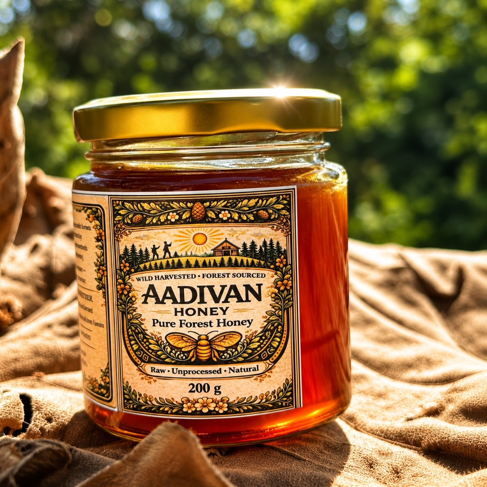

# 🍯 Aadivan Honey — Pure Wild Forest Honey

An artisanal, high-conversion modern web application for **Aadivan Honey** — 100% raw, unheated, single-origin wild forest honey sourced from natural forest canopies.



---

## ✨ Features

- **🍯 Artisanal & Modern D2C UI**: Elegant visual hierarchy, responsive typography, and organic emerald & honey amber color system.
- **✨ Animated Honey Splash Screen**: Golden dripping honey animation with seamless auto-reveal and skip option.
- **📱 WhatsApp Direct Checkout**: One-click WhatsApp ordering with pre-formatted product sizing, quantities, and totals in INR.
- **📦 Interactive Pantry & Cart**: Real-time quantity steppers `[ - ] [ + ]` with instant price computation.
- **🔍 Physical Label Verification**: Direct photos showing actual FSSAI certification, pure honey credentials, and zero added sugar guarantee.
- **⚖️ Conventional vs Raw Comparison**: Side-by-side purity comparison table.
- **🌲 Immersive Brand Story**: Parallax-style forest canopy visual section.
- **🔒 High Security**: Zero vulnerabilities, strict XSS prevention, sanitized links (`rel="noopener noreferrer"`), and environment variable isolation.

---

## 🛠️ Tech Stack

- **React 19**
- **Vite 6**
- **Lucide Icons**
- **Vanilla CSS3** (Modular, responsive, high-performance)

---

## 🚀 Getting Started

### 1. Clone the repository
```bash
git clone https://github.com/Ani02p/AADIVAN-HONEY.git
cd AADIVAN-HONEY
```

### 2. Install dependencies
```bash
npm install
```

### 3. Configure Environment Variables
Copy `.env.example` to `.env` and set your business WhatsApp phone number:
```bash
cp .env.example .env
```

In `.env`:
```env
VITE_WHATSAPP_NUMBER=919876543210
```

### 4. Run Development Server
```bash
npm run dev
```

### 5. Production Build
```bash
npm run build
npm run preview
```

---

## 📄 License
Private & Proprietary — © Aadivan Honey. All rights reserved.
